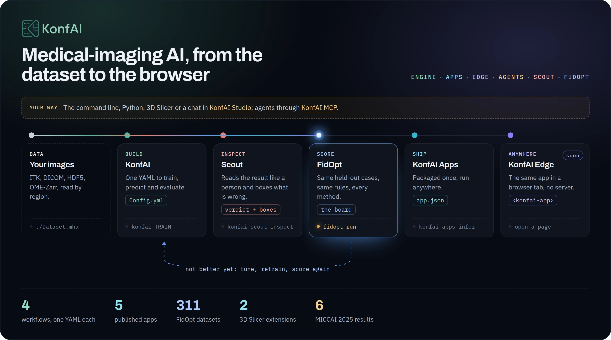

<p align="center">
  <a href="https://fideus-labs.github.io/KonfAI/"></a>
</p>

<p align="center">
  <a href="https://pypi.org/project/konfai/"></a>
  <a href="https://www.python.org/"></a>
  <a href="https://github.com/fideus-labs/KonfAI/actions/workflows/konfai_ci.yml"></a>
  <a href="https://konfai.readthedocs.io/en/latest/"></a>
  <a href="https://github.com/fideus-labs/KonfAI/blob/main/LICENSE"></a>
</p>

<p align="center">
  <a href="https://fideus-labs.github.io/KonfAI/"><strong>Website</strong></a>
  · <a href="https://konfai.readthedocs.io/en/latest/"><strong>Docs</strong></a>
  · <a href="https://konfai.readthedocs.io/en/latest/quickstart.html"><strong>Quickstart</strong></a>
  · <a href="https://konfai.readthedocs.io/en/latest/usage/apps.html"><strong>Apps</strong></a>
  · <a href="https://huggingface.co/VBoussot"><strong>Hugging Face</strong></a>
  · <a href="https://fidopt.io/"><strong>FidOpt</strong></a>
  · <a href="https://www.arxiv.org/abs/2508.09823"><strong>Paper</strong></a>
</p>

**KonfAI is a declarative medical-imaging execution engine, and the family around it.** One configuration trains,
predicts and evaluates a model, patch by patch, on images of any size, and the resolved YAML is the record of the run.
Around the engine, the same method is inspected by Scout, scored by FidOpt on 311 datasets, and shipped as an app to
the command line, 3D Slicer, Hugging Face and, with KonfAI Edge, a browser tab. You drive it from the command line,
Python, 3D Slicer or a conversation in KonfAI Studio; an agent reaches the same pieces through KonfAI MCP.

The whole family on one page: **[fideus-labs.github.io/KonfAI](https://fideus-labs.github.io/KonfAI/)**.

## The family

| Piece | What it does | Get it |
| --- | --- | --- |
| **KonfAI** | The engine, this repository. `TRAIN`, `PREDICTION`, `EVALUATION` and `TRANSFORM`, each from one YAML; regional reads from ITK, DICOM, HDF5 and OME-Zarr; test-time augmentation, ensembles, overlap reconstruction and geometry handled for you | `pip install "konfai[imaging]"` |
| **KonfAI Apps** | One contract for a packaged model, from a folder, Hugging Face or an HTTP server. Five published: TotalSegmentator-KonfAI, MRSegmentator-KonfAI, ImpactSynth, ImpactSeg, IMPACT-Reg | `pip install konfai-apps` · [`apps/`](apps) · [Hugging Face](https://huggingface.co/VBoussot) |
| **3D Slicer** | SlicerKonfAI runs the apps, with evaluation and uncertainty; SlicerImpactReg runs the registration presets and inspects their results | [SlicerKonfAI](https://github.com/vboussot/SlicerKonfAI) · [SlicerImpactReg](https://github.com/vboussot/SlicerImpactReg) |
| **KonfAI MCP** | Fifty tools, one per object: an agent inspects a dataset, writes and validates configs, launches, follows and compares runs, and packages an app | `pip install konfai-mcp` · [guide](https://konfai.readthedocs.io/en/latest/usage/mcp.html) |
| **KonfAI Studio** | A chat web UI over the MCP server: inspect, train, predict, evaluate, compare and view the volumes from one conversation, with your own model endpoint | `pip install konfai-studio` · [guide](https://konfai.readthedocs.io/en/latest/usage/studio.html) |
| **KonfAI Scout** | Looks at a segmentation, a registration or a synthesis the way a person would at a viewer, and reports where it is wrong, with the views that show it and KonfAI Eval's measurements | [`konfai-scout/`](konfai-scout) |
| **KonfAI Edge** | The Rust runtime that runs the apps in a browser tab with no server, as Web Components another page embeds with one import; its demo is coming to the website | [what it is](https://fideus-labs.github.io/KonfAI/docs/edge.html) |
| **FidOpt** | An open benchmark for registration, segmentation and synthesis: 311 datasets, 3,353 held-out test cases, one evaluation for every method. A method on its board is a KonfAI app | [fidopt.io](https://fidopt.io/) |

## Where it goes

> An agent that develops a method should be able to ask a trusted service how good it is, and iterate, the way a
> person submits to a challenge, but in a loop. ([FidOpt](https://fidopt.io/))

Each piece above is one stage of that loop. KonfAI runs a method, Scout inspects its results, FidOpt judges it on a
hidden test, and what wins ships as an app anyone can run, from the command line, 3D Slicer or a browser tab. A person
can drive every stage, and so can an agent.

KonfAI has powered **top-ranking MICCAI 2025 challenge results** across segmentation, registration and synthesis:
[SynthRAD2025 T1](https://github.com/vboussot/Synthrad2025_Task_1) ·
[SynthRAD2025 T2](https://github.com/vboussot/Synthrad2025_Task_2) ·
[CURVAS PDACVI](https://github.com/vboussot/CurvasPDACVI) ·
[TrackRAD2025](https://github.com/vboussot/TrackRAD2025) ·
[Panther](https://github.com/vboussot/Panther) ·
[CURVAS](https://github.com/vboussot/CURVAS).
**Paper:** [KonfAI: A Modular and Fully Configurable Framework for Deep Learning in Medical Imaging](https://www.arxiv.org/abs/2508.09823)
(Boussot & Dillenseger, 2025).

## Where to start

- **The whole picture?** The [website](https://fideus-labs.github.io/KonfAI/).
- **Running a published model?** One command, see [Real workloads](#real-workloads-one-app-contract).
- **Adapting an experiment?** The [Quickstart](#quickstart-first-smoke-run): train, predict, evaluate.
- **Building an app?** [`konfai-apps`](https://konfai.readthedocs.io/en/latest/usage/apps.html).
- **Working through an agent?** [KonfAI MCP](https://konfai.readthedocs.io/en/latest/usage/mcp.html) or [KonfAI Studio](https://konfai.readthedocs.io/en/latest/usage/studio.html).
- **Contributing?** [`AGENTS.md`](https://github.com/fideus-labs/KonfAI/blob/main/AGENTS.md).

---

## The engine

One configuration model connects storage, transforms, model graphs, losses, training, prediction, evaluation and
output geometry. The resolved YAML is the experiment record: inspectable, diffable, and runnable by a researcher or a
program.

```yaml
Trainer:
  Model:
    classpath: UNet.yml          # a model, referenced by name
  Dataset:
    groups_src: { CT: {...}, SEG: {...} }   # channel-first, lazy, patch-based
  epochs: 100                             # the shipped example ships 5, sized for a first run
```

```bash
konfai TRAIN -c Config.yml --gpu 0     # then PREDICTION, then EVALUATION
```

### Why KonfAI?

- **Scale.** Dataset patches can be read regionally from ITK, HDF5, DICOM, and
  OME-Zarr when preprocessing is stream-compatible; a bounded buffer preserves
  correctness when it is not. Prediction owns batching, TTA, ensembles,
  reductions, overlap reconstruction, geometry, and output writing.
- **Reproduce.** Training, prediction, and evaluation share named datasets and
  inspectable model graphs. Defaults are materialised into the YAML and configs
  travel with run artifacts.
- **Ship and automate.** Package the stable workflow as a local, Hugging Face,
  or remote App, use it from 3D Slicer, or let an MCP client operate the same
  validated builders and workspaces.

Already use another stack? Keep it. KonfAI can instantiate regular PyTorch and
MONAI components, and its catalog includes documented compatibility paths for
selected MONAI, nnU-Net, torchvision, and segmentation-models-pytorch models.
[See when to use KonfAI, or another tool.](https://konfai.readthedocs.io/en/latest/usage/adopting-konfai.html)

### One engine owns the complete medical workflow

| Layer | What KonfAI makes executable |
| --- | --- |
| **Storage and data** | Cases, modality groups, geometry, regional reads, transforms, cache/buffer policy, dataset patches |
| **Learning** | Named model graph, intermediate supervision, losses, metrics, optimizer, schedules, dataset- and model-level patching |
| **Inference** | Checkpoints, patch batches, TTA, ensembles, reductions, overlap blending, inverse transforms, medical-image outputs |
| **Evidence** | Resolved configs, checkpoints, statistics, predictions, per-case and aggregate evaluation JSON |
| **Delivery** | Local/Hugging Face Apps, HTTP jobs, external 3D Slicer client, uncertainty, evaluation, fine-tuning |
| **Automation** | Dataset inspection, config validation, smoke tests, jobs, metrics, run comparison through MCP |

That vertical integration is the product. YAML is its durable, inspectable
interface, not the value proposition by itself.

## Real workloads, one App contract

The same App interface already ships full segmentation, synthesis and
registration systems, not reduced demonstration networks:

| App | Workload | Medium case (249 × 246 × 246), RTX PRO 5000 |
| --- | --- | --- |
| **TotalSegmentator-KonfAI** | CT: 117 labels / 5 models · MRI: 50 labels / 2 models | **CT `total`: 17.7 s / 5.2 GB RAM / 15.4 GB VRAM**: 1.8–3.9× faster, 2.7–4.8× less host RAM than the original |
| **MRSegmentator-KonfAI** | MRI: 40 labels, 5-fold ensemble | **21 s / 5.3 GB RAM / 16.3 GB VRAM**: 1.1–1.7× faster, 1.4–5.4× less host RAM than the original |
| **ImpactSynth** | three MR/CBCT→sCT variants, 2.5D UNet++, 5 models each | `MR`: 24.6 s / 2.7 GB RAM / 12.8 GB VRAM |
| **ImpactSeg** | one model segments 11 structures from CT, MRI, or CBCT | 3.3 s / 1.7 GB RAM / 3.9 GB VRAM |
| **IMPACT-Reg** | 12 multimodal presets of three engines: elastix+IMPACT, ConvexAdam and FireANTs | `FireANTs#syn`: 108 s / 6.3 GB RAM / 16.0 GB VRAM |

Every figure is the medium case of the bundle's own small/medium/large table
(see the bundle READMEs under
[`apps/`](https://github.com/fideus-labs/KonfAI/tree/main/apps)), measured with
`benchmarks/perf/bench_apps.py` on 2026-09-09; the ratios against the original
tools span the three cases. They are evidence of executable scale, not a
cross-task leaderboard. The shared measurement protocol and the runnable harness
are in [`benchmarks/`](https://github.com/fideus-labs/KonfAI/tree/main/benchmarks).
The bundles share the same App contract across local directories,
Hugging Face and HTTP, with SlicerKonfAI for general Apps and SlicerImpactReg
for dedicated registration.

Consuming a published workflow does **not** require authoring YAML. Install its
task-specific CLI and run one command, or address the same bundle through
`konfai-apps`; the complete configuration remains available when you need to
inspect, evaluate, fine-tune, or automate it.

```bash
pip install impact_synth_konfai
impact-synth-konfai synthesize MR -i input_mr.nii.gz -o output/

# The same packaged workflow through the generic App runtime
konfai-apps infer VBoussot/ImpactSynth:MR -i input_mr.nii.gz -o output/
```

---

## Install

```bash
pip install "konfai[imaging]"     # core + all imaging backends (recommended)
pip install konfai                # core only (bring your own data reader)
```

`[imaging]` pulls SimpleITK / h5py / pydicom / zarr, needed to read `.mha`,
`.nii.gz`, DICOM, and OME-Zarr. For the full extras matrix (`smp`, `lpips`,
`export`, `cluster`, …) and a reproducible Pixi setup, see the
[installation guide](https://konfai.readthedocs.io/en/latest/getting-started/installation.html).

---

## Four workflows, four configs

KonfAI is command-driven; each CLI state maps to one YAML file:

| Command | Config | Does |
| --- | --- | --- |
| `konfai TRAIN` / `RESUME` | `Config.yml` (`Trainer:`) | fit a model |
| `konfai PREDICTION` | `Prediction.yml` (`Predictor:`) | patch/TTA/ensemble inference → datasets |
| `konfai EVALUATION` | `Evaluation.yml` (`Evaluator:`) | metrics on saved predictions |
| `konfai TRANSFORM` | `Transform.yml` (`Transformer:`) | dataset preparation: a transform chain → datasets (1→1, N→1, 1→N) |

Full CLI reference (flags, `konfai-cluster`, `konfai-apps`):
[docs/reference/cli](https://konfai.readthedocs.io/en/latest/reference/cli.html). The words with
two meanings (group, fold, worker, workspace, bundle):
[docs/reference/glossary](https://konfai.readthedocs.io/en/latest/reference/glossary.html).

The same four workflows are Python callables, with structured results and the
config tree as a dict, which is the idiom for a sweep or a notebook:

```python
import konfai
from konfai.data.transform import Reduce, Resample, Write

result = konfai.transform("template", "./Cohorte:mha",
    {"CT": {"CT": [Resample(reference="atlas_000", reference_group="CT"),
                   Reduce(operator="Median", output="template", grid="strict"),
                   Write(dataset="./Template:mha")]}})
result.outputs   # where each deliverable landed
```

`konfai.plan_transform` returns the plan without running it; `konfai.train`,
`konfai.predict` and `konfai.evaluate` take a config path or the same tree as a
dict. → [**Python workflows**](https://konfai.readthedocs.io/en/latest/usage/python-api.html).

---

## Quickstart (first smoke run)

Train, predict and evaluate a two-class segmentation on four tiny synthetic CT
volumes: one CPU, no dataset to download, and a final check of the files the run
writes.

```bash
git clone https://github.com/fideus-labs/KonfAI.git
python -m venv .venv && . .venv/bin/activate
python -m pip install "./KonfAI[itk]"
cp -r KonfAI/examples/Segmentation/TwoClasses konfai-first-run && cd konfai-first-run

export OMP_NUM_THREADS=1
python quickstart.py prepare
konfai TRAIN -y --cpu 1 --config Config.yml
python quickstart.py checkpoint
konfai PREDICTION -y --cpu 1 --config Prediction.yml --models "$(python quickstart.py checkpoint)"
konfai EVALUATION -y --cpu 1 --config Evaluation.yml
python quickstart.py verify
```

> After a run, `Config.yml` will contain the resolved defaults KonfAI
> materialised. That's expected, and it's what makes runs reproducible.

`verify` fails unless the four predictions carry the geometry of their CT and
the Dice values in `Metric_TRAIN.json` match the written files. The
[**Quickstart**](https://konfai.readthedocs.io/en/latest/quickstart.html) says
what each file is and how to adapt the three configs to your own CT.

The next step trains 41 classes on real pelvis CT, a GPU recommended: run every
cell of
[`examples/Segmentation/Segmentation_demo.ipynb`](https://github.com/fideus-labs/KonfAI/blob/main/examples/Segmentation/Segmentation_demo.ipynb),
which downloads the demo data, trains, predicts, evaluates and plots the result.
Its `epochs: 5` walks the whole path without producing a useful model; raise it
to 100+ for a real run.

### Bring your model (no YAML)

A model you already have goes through the same engine in two calls, the
patching, the overlap blending, the streamed writes and the run record included:

```bash
pip install "konfai[itk,monai]"   # .mha through SimpleITK, and the MONAI UNet below
```

```python
import konfai
from monai.networks.nets import UNet
from konfai.data.transform import Argmax, TensorCast
from konfai.metric.measure import CrossEntropyLoss

if __name__ == "__main__":
    model = UNet(spatial_dims=2, in_channels=1, out_channels=41, channels=(32, 64, 128, 256), strides=(2, 2, 2))
    checkpoints = konfai.train_model(model, "./Dataset:mha", inputs="CT", targets="SEG", loss=CrossEntropyLoss(),
                                     patch=[1, 256, 256], epochs=20, batch_size=8,
                                     transforms={"SEG": [TensorCast(dtype="int64")]})
    konfai.predict_model(model, "./Dataset:mha", inputs="CT", patch=[1, 256, 256], output="./Pred:mha",
                         checkpoints=sorted(checkpoints.glob("[0-9]*.pt"))[-1],
                         final_transforms=[Argmax(), TensorCast(dtype="uint8")])
```

[`examples/BringYourModel/BringYourModel_demo.ipynb`](https://github.com/fideus-labs/KonfAI/blob/main/examples/BringYourModel/BringYourModel_demo.ipynb)
runs it on the demo data; a MONAI Bundle imports the same way
(`konfai.import_bundle`), see [**Adopt from PyTorch/MONAI**](https://konfai.readthedocs.io/en/latest/usage/adopting-konfai.html).

---

## How volumes are read

Volumes are read as patches. Whether the volume is *also* held in RAM depends on
the workflow's loading regime (training caches, and `memory_budget` makes that
adaptive; prediction, evaluation and transform read each case once and never
cache) and on whether your preprocessing chain can be streamed. KonfAI derives
streamability from the transforms you declared:

| Regime | When | Memory held |
| --- | --- | --- |
| **Cache** | training default | every case, resident for the whole run |
| **Stream** | predict/eval default or budget exceeded; transform default; chain streamable | one patch, or a budget-sized slab under `TRANSFORM` |
| **Buffer** | predict/eval, or training over its budget; chain not streamable | predict/eval: two cases, the one being finished and the next; training: a FIFO of `max(batch_size + 1, shuffle_window)` cases |
| **Whole-volume** | transform, chain not streamable | one case plus one in-flight copy |

A chain streams when every step declares the region it needs: the exact patch
(`OneHot`), a halo (`Dilate`), a remap (`Flip`), a resample (`Resample`),
or a whole-volume statistic read once from disk (`Normalize`). Under
`TRANSFORM`, peak host memory follows the declared `memory_budget`, not the
volume: `python benchmarks/bench_streaming.py --gib 16 --budget 1` runs a
TRANSFORM chain over a 16 GiB volume under a 1 GiB budget and reports the peak
resident set of the whole process tree (protocol:
[**Reproducing the numbers**](https://konfai.readthedocs.io/en/latest/usage/large-images.html#reproducing-the-numbers)).

`konfai TRANSFORM` decides that per case *before* it writes a byte: STREAM or
LOAD, WHOLE-VOLUME naming the stage that refused to stream, REDUCE or REFUSED
for a reduction, SKIP when the output already exists. The console gets a
one-line summary; the run's log opens with the plan in full.
`--plan` prints that full report and stops without transforming.

→ [**Patch streaming**](https://konfai.readthedocs.io/en/latest/usage/large-images.html#patch-streaming): what streams, what does not, and why.

---

## What's in the box

Everything below is referenceable by name in YAML. See the
[**built-in component catalogue**](https://konfai.readthedocs.io/en/latest/reference/components/models.html)
for classpaths and constructor arguments.

| Kind | Examples | Catalogue |
| --- | --- | --- |
| **Models** | `UNet`, `NestedUNet`, `ResNet`, `VAE`, `VoxelMorph`, GAN/diffusion families | [models](https://konfai.readthedocs.io/en/latest/reference/components/models.html) |
| **Losses & metrics** | `Dice`, `MAE`, `PSNR`, `SSIM`, `LPIPS`, `FID`, `CrossEntropyLoss`, `TRE`, `IMPACTReg`, `IMPACTSynth` | [losses-metrics](https://konfai.readthedocs.io/en/latest/reference/components/losses-metrics.html) |
| **Transforms** | `Standardize`, `Normalize`, `Clip`, `Resample*`, `OneHot`, `Crop` (~40) | [transforms](https://konfai.readthedocs.io/en/latest/reference/components/transforms.html) |
| **Augmentations** | `Flip`, `Rotate`, `Elastix`, `Noise`, `CutOUT` (~15) | [augmentations](https://konfai.readthedocs.io/en/latest/reference/components/transforms.html#augmentations) |
| **Schedulers** | weight (`Constant`, `CosineAnnealing`) + LR (`PolyLRScheduler`, `Warmup`, any torch) | [schedulers](https://konfai.readthedocs.io/en/latest/reference/components/losses-metrics.html#schedulers) |
| **Storage backends** | ITK, HDF5, DICOM series, OME-Zarr | [storage-backends](https://konfai.readthedocs.io/en/latest/reference/components/storage-backends.html) |

Not limited to these: any importable class (`monai.losses:DiceLoss`,
`torch:nn:L1Loss`, or a local `Model:MyNet`) works via the `module:Class` form.

---

## Automate workflows through MCP

KonfAI is built to serve as a **deterministic backend for LLM-driven
experimentation**. Through the **KonfAI-MCP server**, a client can:

- inspect datasets and infer their structure
- generate and validate YAML configurations
- launch training / prediction / evaluation / transform runs
- read live metrics, compare runs, and iterate

Every execution stays **reproducible, structured, and grounded in the same YAML
workflows** a human would run, bridging LLM reasoning and real experimental
execution. See the [ecosystem map](https://konfai.readthedocs.io/en/latest/usage/apps.html#the-ecosystem-around-an-app)
for the current status.

---

## KonfAI Studio

**[KonfAI Studio](https://konfai.readthedocs.io/en/latest/usage/studio.html)** is
a single chatbot web UI over the MCP server. Point it at your own dataset and,
from the conversation alone, inspect the data, author or reuse a model, train,
predict, evaluate, compare runs, and view the volumes in a built-in NiiVue
viewer. Every step is a `konfai-mcp` tool call, the compute staying on your
machine. It is a product surface over `konfai-mcp`, not a new engine, and it
ships **no API key**: you bring your own LLM, your Claude Code subscription by
default, the Claude API with your key, or a fully local OpenAI-compatible server
such as Ollama or vLLM.

```bash
pip install konfai-studio
konfai-studio            # -> http://127.0.0.1:8730
```

→ **[KonfAI Studio](https://konfai.readthedocs.io/en/latest/usage/studio.html)**

---

## Documentation

**Full docs: <https://konfai.readthedocs.io/en/latest/>**

- [Quickstart](https://konfai.readthedocs.io/en/latest/quickstart.html): first end-to-end run
- [Core concepts](https://konfai.readthedocs.io/en/latest/config_guide/index.html): how YAML becomes Python objects
- [Large images](https://konfai.readthedocs.io/en/latest/usage/large-images.html): regional reads, fallback, and tuning
- [Adopt from PyTorch/MONAI](https://konfai.readthedocs.io/en/latest/usage/adopting-konfai.html): reuse and tool choice
- [Component catalogue](https://konfai.readthedocs.io/en/latest/reference/components/models.html): everything you can configure
- [Examples](https://konfai.readthedocs.io/en/latest/examples/index.html): runnable Segmentation, Synthesis & Registration workflows, a model of your own in ten lines, a public 2.4 GB OME-Zarr read where it lives, plus five published-app demos

**Docker:** `vboussot/konfai`,
[guide](https://konfai.readthedocs.io/en/latest/getting-started/installation.html#docker).

---

## Development & contributing

```bash
git clone https://github.com/fideus-labs/KonfAI.git && cd KonfAI
pixi install
pixi run test      # run the test suite
pixi run check     # lint + format-check + test (run before pushing)
```

Contributions are welcome: improve examples, clarify docs, add tests, or extend
models / transforms / apps. See the
[developer guide](https://konfai.readthedocs.io/en/latest/development.html).

**Contributors:** start with [`AGENTS.md`](https://github.com/fideus-labs/KonfAI/blob/main/AGENTS.md), the canonical
reference for conventions, commands, and repository rules. The docs site also
publishes [llms.txt](https://konfai.readthedocs.io/en/latest/llms.txt) and
[llms-full.txt](https://konfai.readthedocs.io/en/latest/llms-full.txt): the
quickstart, config guides and component catalog in one plain-text file.

---

## Citation

```bibtex
@article{boussot2025konfai,
  title   = {KonfAI: A Modular and Fully Configurable Framework for Deep Learning in Medical Imaging},
  author  = {Boussot, Valentin and Dillenseger, Jean-Louis},
  journal = {arXiv preprint arXiv:2508.09823},
  year    = {2025}
}
```

Licensed under [Apache-2.0](https://github.com/fideus-labs/KonfAI/blob/main/LICENSE).
